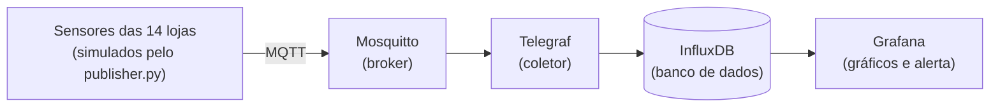

# FrioCerto: monitoramento da câmara fria

## O cenário

A FrioCerto é uma rede de 14 farmácias no ABC paulista que guarda remédios que precisam ficar sempre entre 2 °C e 8 °C, como insulina e vacinas. Uma loja já foi multada pela Vigilância Sanitária porque não conseguiu provar que a câmara fria se manteve estável durante uma queda de energia. Por isso a diretoria quer um sistema próprio que meça a temperatura o tempo todo, avise o farmacêutico de plantão quando passar de 8 °C por mais de 5 minutos e guarde o histórico por 5 anos para as auditorias da Anvisa.

Este projeto é o laboratório que testa essa ideia na prática. Em vez de 14 sensores reais, um único script em Python simula as 14 lojas.

## Como funciona (arquitetura)



Resumindo o caminho: o sensor manda a temperatura para o Mosquitto, o Telegraf pega essas mensagens e grava no InfluxDB, e o Grafana mostra os gráficos e dispara o alerta.

## Como rodar

Precisa ter o Docker instalado. Na pasta do projeto:

```
docker compose up -d
docker compose ps
```

Depois de uns 40 segundos, os 4 serviços devem aparecer como `healthy`.

- **Grafana:** http://localhost:3000 (usuário `admin`, senha `admin`; ele pede para trocar, pode pular)
- **InfluxDB:** http://localhost:8086 (usuário `admin`, senha `friocerto123`)

No Grafana, a fonte de dados é o InfluxDB com a URL `http://influxdb:8086`, organização `friocerto`, bucket `sensores` e o token `dev-token-please-change`.

## Como testar a anomalia

Instale a biblioteca e rode o simulador:

```
pip install paho-mqtt
python publisher/publisher.py
```

O script manda a temperatura das 14 lojas a cada 2 segundos (no mundo real seria a cada 60). Todas ficam entre 3 °C e 7 °C, menos a **loja_07**: depois de 2 minutos ela passa a mandar cerca de 12 °C e não volta mais. No Grafana, essa loja sobe acima da linha de 8 °C no gráfico, e depois de 5 minutos o alerta passa de Normal para Pending e depois para Firing.

Para ver as mensagens chegando em tempo real:

```
docker compose exec mosquitto mosquitto_sub -t "friocerto/#" -v
```

## Por que escolhi cada tecnologia

**MQTT.** É um protocolo feito para dispositivos pequenos mandarem dados de forma leve. Como o Wi-Fi das lojas às vezes cai, é bom o sensor só mandar a mensagem para o broker, sem depender de o servidor central estar de pé naquele instante.

**QoS 1.** O QoS é o nível de garantia de entrega. O nível 0 pode perder mensagem, e perder leitura é um problema aqui, porque precisamos provar a temperatura na auditoria. O nível 1 garante que a mensagem chega pelo menos uma vez (se chegar repetida, não atrapalha). O nível 2 é mais pesado e não traria vantagem para leitura de temperatura.

**InfluxDB (e não PostgreSQL).** O InfluxDB é feito para dados que chegam o tempo todo com data e hora, como temperatura. Ele já tem retenção por tempo (dá para configurar os 5 anos) e funciona bem com o Grafana. No PostgreSQL daria para fazer, mas precisaria de mais configuração para o mesmo resultado.

**Mosquitto (e não EMQX).** São só 14 sensores mandando dados, então o Mosquitto, que é leve e simples, resolve. O EMQX é mais indicado para muitos milhares de dispositivos, e a diretoria tem orçamento apertado.

**Telegraf.** Ele já vem pronto para ler do MQTT e gravar no InfluxDB, então não precisei programar essa parte.

## Problemas que apareceram no lab

- O alerta do Grafana deu erro de formato dos dados (`wide series`) até eu ajustar a consulta.
- Uma configuração do painel estava escondendo todas as lojas menos uma, e precisei remover para aparecerem as 14.

## Aviso

As senhas e o token deste projeto são só de laboratório. Em produção seria preciso trocar tudo.
